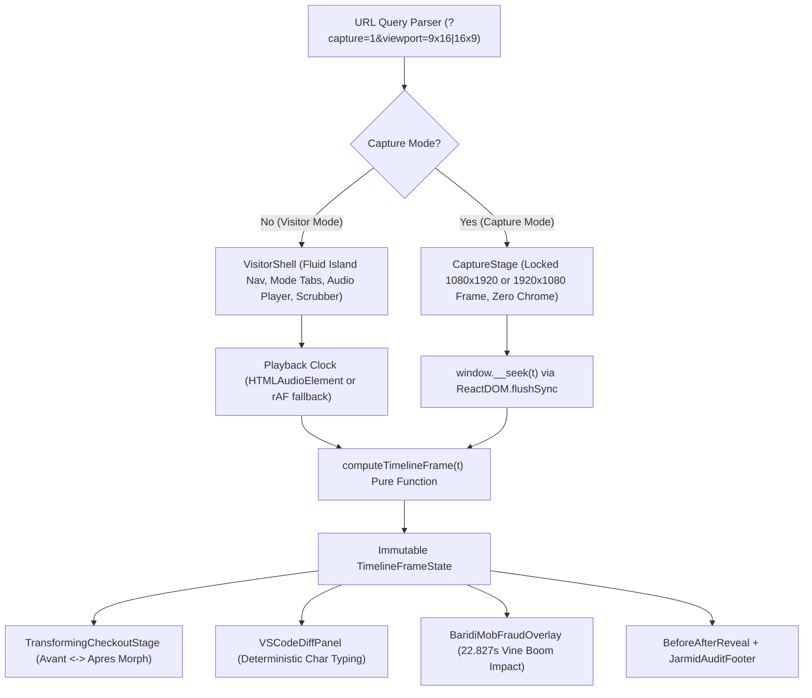

# Technical Requirements Document (TRD): DZ Veste Checkout Showcase

**Document ID:** `02_TRD.md`
**Project:** `dz_veste_checkout_showcase` (`D:\Downloads\JP\demos\dz_veste_checkout_showcase`)
**Author:** Khalef Abdelmadjid (JARMID)

## 1. System Architecture Topology

The application is a single-page React 19 client application structured around a pure deterministic timeline kernel (`src/engine/timeline.ts`) shared identically by both Interactive Visitor Mode and Deterministic Capture Mode.

## 2. Stack and Pinned Package Versions

- **Runtime & Build:** Node 24.x, Vite `^6.2.0`, `@vitejs/plugin-react` `^4.3.4`, TypeScript `^5.8.0` (strict mode).
- **UI Framework:** React `^19.1.0`, ReactDOM `^19.1.0`.
- **Styling:** Tailwind CSS `^4.1.0` with official `@tailwindcss/vite` `^4.1.0` plugin (`@import "tailwindcss";` + `@theme` custom tokens in `src/index.css`).
- **Motion:** `motion` (`motion/react` `^12.7.0`) for Visitor Mode interactive micro-interactions (`MotionConfig reducedMotion="user"`), paired with pure deterministic easing curves in `src/engine/easing.ts` for frame-exact `window.__seek(t)` rendering.
- **Icons:** `@phosphor-icons/react` `^2.1.7` (single unified icon family, zero raw emojis as UI icons).
- **Self-Hosted Typography:** `@fontsource/space-grotesk`, `@fontsource/plus-jakarta-sans`, `@fontsource/jetbrains-mono`, `@fontsource/cairo` (100% offline deterministic rendering, zero Google Fonts network stalls during Playwright capture).
- **Testing & Verification:** `vitest` `^3.1.0` for timeline and domain unit tests; Python Playwright headless Chromium for 12-frame dual-viewport visual verification.

## 3. Deterministic `window.__seek(t)` Contract

To guarantee identical frame rendering at 60fps regardless of machine speed or Playwright capture timing:
1. `window.__seek(t: number): number` clamps `t` to `[0, 49.43]`, invokes `flushSync(() => setSeekTime(clamped))`, and returns `clamped`.
2. `window.__duration = 49.43` and `window.__seekReady = true` are exposed on `window` once the root mounts and `document.fonts.ready` resolves.
3. In `?capture=1` mode, the root container sets `data-capture="true"`, which suppresses all CSS `transition` durations and infinite CSS `@keyframes` animations so every visual property derives exclusively from `computeTimelineFrame(t)`.
4. Only GPU-composited properties (`transform`, `opacity`, `clip-path`, `filter`) animate continuously. Layout properties (`width`, `height`, `top`, `left`) remain static or snap cleanly inside isolated morphing elements during non-scrolling state changes.

## 4. Dual-Viewport Parametric Stage Geometry

| Parameter | `16:9` Widescreen (`?capture=1&viewport=16x9`) | `9:16` Vertical (`?capture=1&viewport=9x16`) |
| :--- | :--- | :--- |
| Canvas | `1920px x 1080px` (`overflow: hidden`) | `1080px x 1920px` (`overflow: hidden`) |
| Safe Box | `X: 64..1856`, `Y: 52..1028` | `X: 56..1008`, `Y: 155..1600` (clears IG top header, bottom caption, right action stack) |
| Layout Split | Horizontal 2-column stage: Left `1080px` Checkout Canvas + Right `680px` Code Diff / Fraud / Audit Rail | Vertical stacked stage inside safe box: Top header pill (`64px`) + Center Mobile Checkout Stage (`860px`) + Bottom Contextual Panel (`470px`) |
| Minimum Readable Font | `16px` body / `18px` code / `44px` display | `20px` body / `21px` code / `48px` display |

## 5. Alternatives Considered

1. **GSAP Imperative DOM Tweening vs. Pure React Functional Time State:**
   - *Rejected by author:* Driving 25+ nested React states with imperative GSAP `.seek()` mutates DOM nodes behind React's virtual DOM, causing state desynchronization when visitors switch between interactive mode and animated playback. Computing a pure `TimelineFrameState` from `t` and rendering through `flushSync` keeps one single source of truth for both interactive UX and 60fps capture.
2. **External Google Fonts `<link>` vs. Self-Hosted `@fontsource` Packages:**
   - *Rejected by author:* External font stylesheets can time out or substitute fallback metrics during offline Playwright batch renders. Bundling `@fontsource` WOFF2 files inside Vite guarantees deterministic text metrics on frame 0.
3. **Separate HTML Capture File vs. Unified React SPA (`?capture=1`):**
   - *Rejected by author:* Maintaining a standalone capture HTML duplicates every component and creates visual drift between the live JARMID demo and the recorded Instagram Reel. Query-driven mode switching keeps 100% component parity.

## 6. Non-Functional Requirements

- **Frame Determinism:** Calling `window.__seek(22.83)` twice in any order produces pixel-identical DOM state.
- **Compositor Budget:** Zero `transition: all` declarations; zero scroll listeners driving animation; zero `localStorage` or `sessionStorage` calls.
- **Accessibility:** Interactive "Apres" mode enforces WCAG AA+ contrast (`>= 4.5:1` body, `18.6:1` primary CTA), `:focus-visible` outlines, semantic labels, and `prefers-reduced-motion` support.
